<p align="center">
  
</p>

<p align="center">
  <strong>A voice-first J.A.R.V.I.S. desk companion on a round 466×466 AMOLED ESP32-S3.</strong><br>
  Native Gemini Live duplex voice, 30 built-in voice tools (24 instant 0 ms offline), Glass 3.7 luminous OLED UI &amp; 10 watch dials (incl. live astronomical Orrery &amp; 32-bar FFT Reactor), AXP2101 80% Desk Battery-Care &amp; 80 MHz rest, Codex Mode 2.0 frosted OLED cards, embedded Wi-Fi Command Deck &amp; Diagnostics Lab, physical privacy, and deep sleep.
</p>

<p align="center">
  <a href="LICENSE"></a>
  
  
  
  
</p>

<p align="center">
  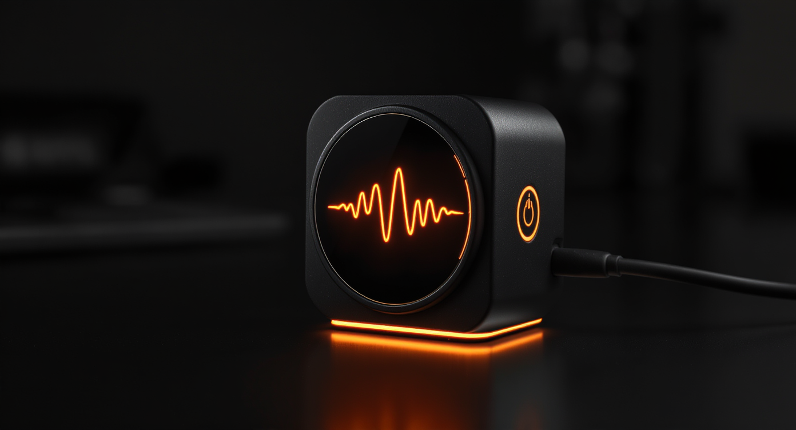
  <br><em>Enclosure concept artwork. Software framebuffer captures from a running unit appear immediately below.</em>
</p>

---

## Live Display Gallery

<p align="center">
  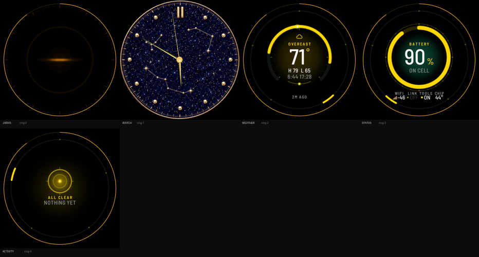
  <br><em>The 5-screen spatial ring: <strong>JARVIS · WATCH · WEATHER · STATUS · ACTIVITY</strong> (plus summoned <strong>DESK</strong> while a companion or agent is live).</em>
</p>

<p align="center">
  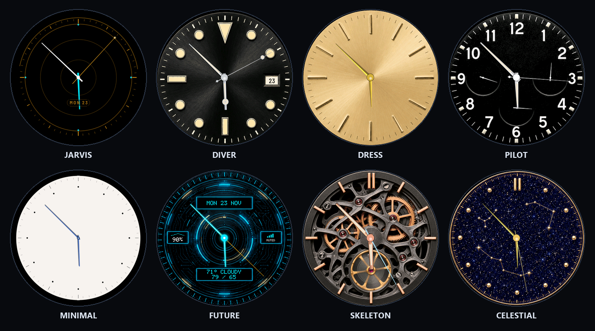
  <br><em>All <strong>10 watch dials</strong>: JARVIS · DIVER · DRESS · PILOT · MINIMAL · FUTURE · SKELETON · CELESTIAL · ORRERY · REACTOR — with IMU tilt lighting/parallax, real-time planetary ephemeris, live audio FFT, and PSRAM dial caching.</em>
</p>

<table>
  <tr>
    <td align="center" width="33%">
      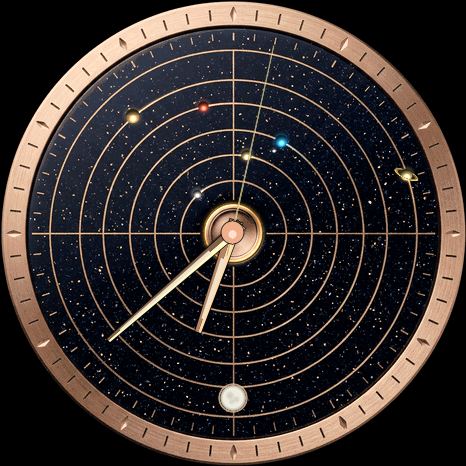<br>
      <sub><strong>Astronomical Orrery</strong><br>Live Mercury–Saturn ephemeris, Saturn rings &amp; Moon phase</sub>
    </td>
    <td align="center" width="33%">
      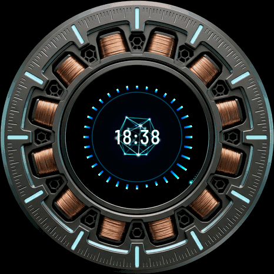<br>
      <sub><strong>Reactor FFT &amp; 3D Core</strong><br>32-bar fixed-point audio FFT + rotating 3D geodesic core</sub>
    </td>
    <td align="center" width="33%">
      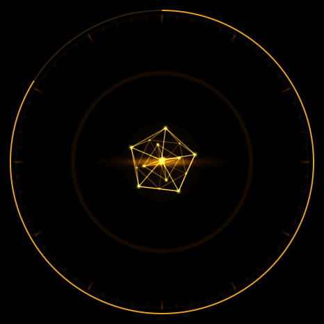<br>
      <sub><strong>3D Holographic Voice Core</strong><br>IMU-tilted 3D lattice reactive to live speech spectrum</sub>
    </td>
  </tr>
  <tr>
    <td align="center" width="33%">
      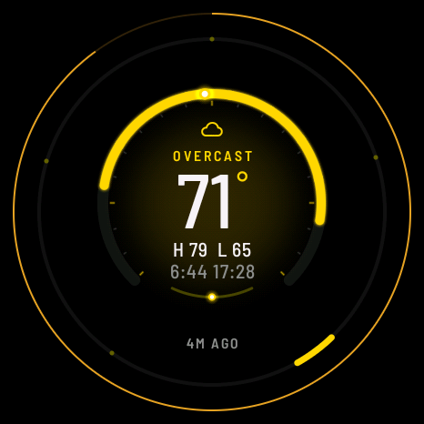<br>
      <sub><strong>Atmospheric Weather</strong><br>On-device fetch, thermal arc, sun orb &amp; rain ring</sub>
    </td>
    <td align="center" width="33%">
      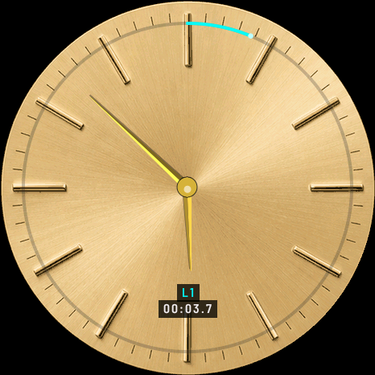<br>
      <sub><strong>Chronograph &amp; Timers</strong><br>4-lap stopwatch, Pomodoro &amp; deep-sleep timers</sub>
    </td>
    <td align="center" width="33%">
      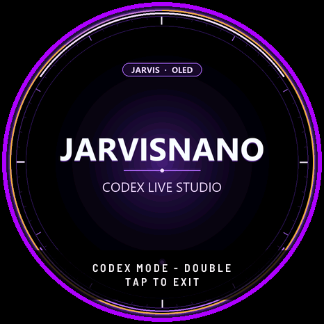<br>
      <sub><strong>Codex &amp; Remote Canvas</strong><br>466×466 RGB565 push, Barlow cards &amp; 1-tap approvals</sub>
    </td>
  </tr>
</table>

> **Provenance:** Every display capture in this repository is a software mirror of the exact RGB565 pixels submitted by the firmware compositor to the CO5300 AMOLED — fetched over the paired LAN client, not camera photographs of the physical glass. See [`docs/evidence/README.md`](docs/evidence/README.md).

---

## What It Does

JarvisNano turns the **Waveshare ESP32-S3-Touch-AMOLED-1.75C** into a standalone, always-ready desk companion. No phone or hub is required for voice, local tools, or UI — and an optional paired ZeroChat phone or Wi-Fi desktop browser can extend it on demand.

**Status:** Active release candidate (`esp32s3_touch_amoled_1_75c` on ESP-IDF 5.5.4). Host test suites (`./scripts/host-tests.sh`, 25 suites) are the offline gate; hardware acceptance items such as signed OTA, TLS/authenticated transport, and attended NVS encryption remain open release gates tracked in [`PLAN.md`](PLAN.md) and [`docs/RELEASE_CHECKLIST.md`](docs/RELEASE_CHECKLIST.md). Four enclosure concepts (`Monolith`, `Cube`, `Egg`, `Radio`) live in [`hardware/enclosure/`](hardware/enclosure/README.md); live captures run on the bare 1.75C board.

| Pillar | Capabilities |
|---|---|
| **Voice-First Gemini Live** | Dedicated `jr_wake` WakeNet9 `"Jarvis"` task (cuts replies on wake word), 24 kHz shared full-duplex I²S clock, 16 kHz AEC-clean uplink, 24 kHz adaptive jitter-buffered speaker playback, DAC-synced speech cadence halo, and 24 kHz multi-harmonic chimes. |
| **30 Built-in Voice Tools** | **24 instant 0 ms offline tools** + **6 JarvisMCP gateway tools** (full breakdown below) — zero network round-trips for timers, ON AIR / Focus / Breathe desk modes, 4-lap stopwatch, tagged NVS desk inbox, battery care, briefings, and device self-control. |
| **Glass 3.7 Luminous OLED** | Single-compositor 466×466 engine: Procedural Ignition cold-boot splash, 5-screen spatial ring (`JARVIS · WATCH · WEATHER · STATUS · ACTIVITY` + addressable `DESK`), **10 watch dials** (incl. 6-planet `ORRERY` + 32-bar FFT `REACTOR`), Chrono-Arc / Aetherium / Atmosphaera / Cortex Command, rotary perimeter bezel scrub, shared evictable PSRAM static plate, 60 Hz TE sync (`GPIO13`), and CO5300 HBM (`0x66`). Glass 3.7 adds four live-switchable screen transitions (`SHUTTER`, `IRIS`, `GLIDE`, `CLASSIC`), plain-language tool status with a 20-second reply gist (`show_gist`), and **Nano Reef**, a persistent virtual aquarium (8 species, 3 biomes) that grows with wall-clock time and is opened by swiping left or from the Control Shade. |
| **Codex Mode 2.0 & Command Deck** | Frosted Barlow OLED approval/consent/progress/result cards (semantic crimson `DENY` / emerald `ALLOW`), live 3-step Cortex DESK checklist, `jarvisctl ask --wait` & `jarvisctl run <cmd>` CI bridge, zero-dependency embedded Command Deck & Diagnostics Lab 2.0 at `http://<device-ip>/` (live CPU%/stack bars, 5-layer render timing, AXP2101 inspector, cursor log tail, 1-click JSON Diag Bundle), plus paired **ZeroChat** phone mode. |
| **AXP2101 Power Care & Privacy** | NVS-persisted **80% Desk Battery-Care** (`4.0 V` CV + 75/80% USB hold hysteresis), dual-sensor chip/PMIC thermal charge throttling, continuous VBAT/VBUS/VSYS/TDIE ADC & rolling ETA analytics, `240 / 160 / 80 MHz` CPU gears, 3-tier Wi-Fi PS (`NONE`/`MIN`/`MAX`), 0-fps still-frame rest, deep sleep with RTC-persisted timers/activity, and **inviolate physical privacy** (inner-disc hold or face-down flip; remote APIs can never unmute). |

### 30 Built-in Voice Tools (24 Offline · 6 Gateway)

| Domain | Scope | Tools |
|---|---|---|
| **Timers, Focus & Desk Modes** | 0 ms offline | `set_timer` (5 s–12 h, silent option, deep-sleep surviving), `cancel_timer`, `list_timers`, `start_focus` (Pomodoro, defaults 25 min), `set_desk_mode` (`on_air`, `focus`, `breathe`, `normal`), `start_breathe`, `stopwatch` (start/stop/4-lap/reset/status) |
| **Desk Inbox & Briefings** | 0 ms offline | `add_note` (WORK/LIFE tagged, NVS-persisted), `list_notes`, `complete_note`, `clear_notes`, `daily_briefing` (date, weather, 12 h rain, notes, timers, tasks, battery) |
| **Time, Weather & Choices** | 0 ms offline | `current_time`, `weather_here` (on-device cached forecast), `ask_user` (interactive choice card on glass) |
| **Device & Power Control** | 0 ms offline | `set_glass` (ring screen & 10 watch styles), `set_volume`, `set_brightness`, `set_sunlight` (CO5300 HBM with chip/PMIC thermal & battery guard), `set_ui_sounds`, `set_battery_care` (80% Desk Care vs 100% Travel), `device_status` |
| **Reply Gist & Nano Reef** | 0 ms offline | `show_gist` (plain-words status of the running tool and a 20-second reply gist), `aquarium` (open, close, feed, clean, shake, add a fish, switch biome, status; biomes reef, abyss, koi) |
| **JarvisMCP Gateway** | HTTPS keep-alive (32 KB PSRAM + JSON projector) | `search_tools`, `execute_tool` (web search, news, weather, crypto, stocks, Wikipedia, calendar — fail-closed allowlist), `recall_memory`, `remember`, `delegate_task`, `delegated_tasks` |

---

## Visual Workflows

### 1. System & Companion Topology

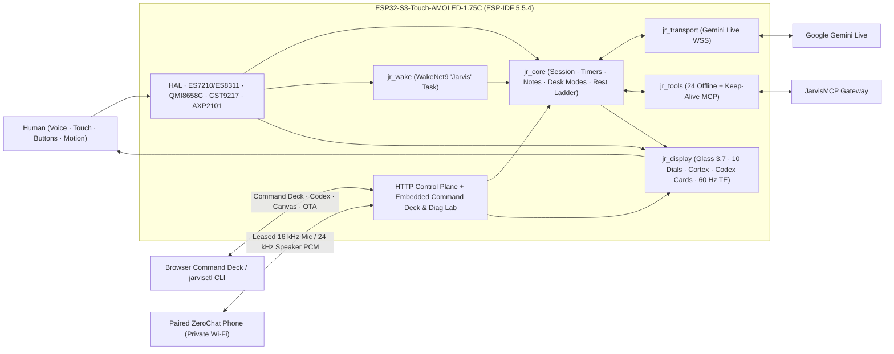

### 2. Voice Turn & Offline-First Tool Flow

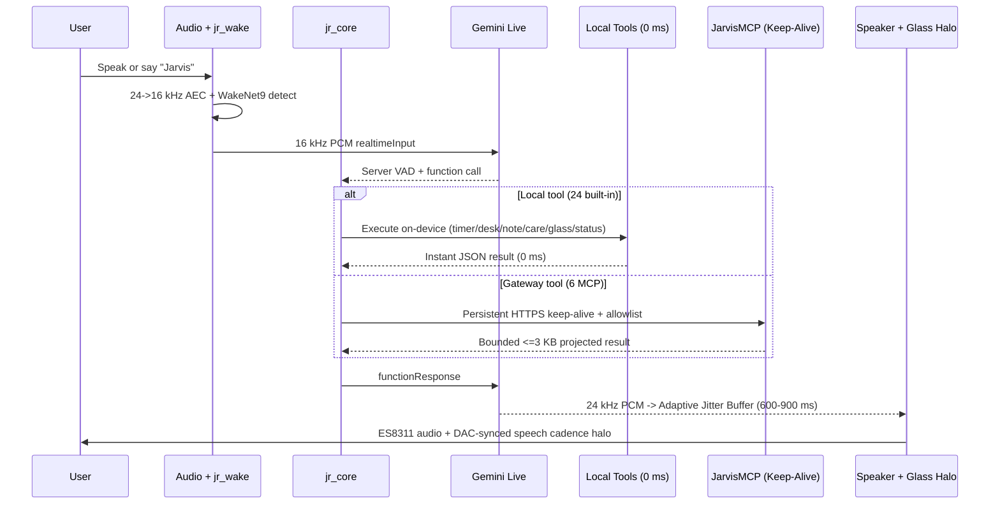

### 3. Adaptive Power & Deep-Sleep Ladder

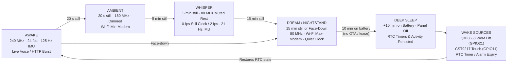

> Below 20% battery off USB, the rest ladder runs **4× faster** and brightness caps to `45%` (`14%` whisper). On USB with **Desk Battery-Care** enabled, AXP2101 caps CV to `4.0 V` and holds at `80%` on VBUS Power-Path. Deep sleep is refused during OTA probation, active companion leases, or USB power.

---

## Hardware & One Interaction Grammar

The **Waveshare ESP32-S3-Touch-AMOLED-1.75C** (32 MB DIO flash, 8 MB octal PSRAM, no TCA9554/PCF85063/microSD) is the only supported build target. Pin map, verified capabilities, and open probes live in [`docs/HARDWARE.md`](docs/HARDWARE.md).

| Subsystem | 1.75C Silicon | Firmware Role |
|---|---|---|
| **MCU & Memory** | ESP32-S3R8 · 8 MB octal PSRAM · 32 MB DIO flash | PSRAM-first heap (`ALWAYSINTERNAL=1024`, `cJSON` in PSRAM), dual 4 MB OTA slots, WakeNet9 model, shared evictable PSRAM render plate |
| **Display** | CO5300 466×466 QSPI AMOLED (`40 MHz`) | Single strip compositor, 60 Hz `LCD_TE` (`GPIO13`) V-blank sync, `0x66` HBM sunlight boost, `DISPOFF/SLPIN` sleep |
| **Touch & IMU** | CST9217 (`GPIO11` INT) · QMI8658C (`GPIO21` INT1) | Single-point gestures + rotary perimeter scrub + touch wake; 125 Hz / 21 Hz accel, tilt lighting/parallax, flip/shake, WoM lift-wake |
| **Audio & Power** | ES7210 + ES8311 + NS4150B · AXP2101 PMIC | Shared 24 kHz clock, 16 kHz AEC uplink, 24 kHz DAC output; 80% Desk Care (`0x64`/`0x18`), thermal foldback (`0x65`/`0x62`), continuous VBAT/VBUS/VSYS/TDIE ADC, soft power-off |

### One Interaction Grammar

| Input | Action |
|---|---|
| **"Jarvis" / PWR short** | Wake & listen (or dismiss a ringing timer); never mutes |
| **PWR hold** | Smooth fade-out and power off completely via PMIC (hold PWR 1 s to power back on) |
| **BOOT short** | Toggle control shade (`L VOL`, `R LGT`, `MUTE/LISTEN`) |
| **BOOT hold 1.5–5 s** | Display 6-digit pairing code and open 60 s pairing window |
| **BOOT hold ≥ 5 s** | Panic-home (dismiss all modals/overlays back to Home) |
| **Perimeter bezel scrub / Rim slide** (`r ≥ 168`) | Rotary arc scrub for Volume (left) or Brightness (right) with live rim arc & tactile ticks |
| **Centre vertical swipe** (`r < 168`) | Walk the ring: `JARVIS ↔ WATCH ↔ WEATHER ↔ STATUS ↔ (DESK) ↔ ACTIVITY`; up/down opens or closes detail sheets |
| **Horizontal swipe** | 10 s WATCH peek; on `WATCH`, step through all **10 watch styles** (`JARVIS · DIVER · DRESS · PILOT · MINIMAL · FUTURE · SKELETON · CELESTIAL · ORRERY · REACTOR`) |
| **Tap** | Dismiss ringing timer, answer Codex/consent card, check off Desk Inbox note, or speak open sheet aloud |
| **Double-tap** | Home (and immediate physical exit from any Codex/ZeroChat lease) |
| **Inner-disc hold** (`r < 168`, 850 ms) | Physical privacy mute/unmute (commit ring fills; rim holds ignored) |
| **Face-down / Shake / Lift** | Face-down ~600 ms = flip privacy; shake = dismiss timer or cancel turn; lift after rest = weather glance / WoM wake |

Full precedence rules and gesture provenance: [`docs/INPUT_MAP.md`](docs/INPUT_MAP.md).

---

## 5-Minute Quick Start

**Requirements:** Docker, Python 3, Git, and a USB-C data cable for the initial flash.

```bash
git clone https://github.com/PascalAI2024/JarvisNano.git
cd JarvisNano

# 1. Build (pinned espressif/idf:v5.5.4 in Docker; use FAST=1 for incremental rebuilds)
./scripts/build-v5.sh
./scripts/smoke-build.sh

# 2. Initial USB flash (1.75C DIO 32 MB, verified, preserves NVS)
./scripts/flash-v5.sh

# 3. Run all 25 host test suites (auto-uses Docker gcc container if no local cc)
./scripts/host-tests.sh
```

Once connected to Wi-Fi, open the embedded **Command Deck** in any browser on your LAN at **`http://<device-ip>/`**, pair once via a 1.5–5 s **BOOT** hold, and ship updates over Wi-Fi (USB-JTAG cannot be re-flashed while the app owns the port):

```bash
export JARVIS_DEVICE_HOST='<device-ip>'

# First-time pairing (stores token in macOS Keychain or Windows HKCU\Software\JarvisNano\Desk)
python3 scripts/jarvis-desk.py --host "$JARVIS_DEVICE_HOST" pair

# 1-command safe release: secrets + JS + 25 host suites -> build + ELF archive -> OTA -> Flight Report
python3 scripts/jarvisctl.py ship --fast

# Power, profiling & live dev workbench
python3 scripts/jarvisctl.py power [--care on|off] [--watch]  # AXP2101, ETA, thermal, CPU/Wi-Fi PS
python3 scripts/jarvisctl.py bench [--dials] [--split]        # per-screen FPS, ms/f & 5-layer breakdown
python3 scripts/jarvisctl.py tasks --cpu                      # live per-task CPU % & stack headroom
python3 scripts/jarvisctl.py tail [--grep PAT]                # zero-duplicate ?since= cursor log stream
python3 scripts/jarvisctl.py crash decode                     # auto-matched archived ELF addr2line
python3 scripts/jarvisctl.py board                            # GPIO13 TE, PWR key, IMU & PMIC probe

# Codex Mode 2.0 agent & CI bridge
python3 scripts/jarvisctl.py ask "Deploy v3.6?" --consent --wait
python3 scripts/jarvisctl.py run --title "TEST SUITE" -- pytest -q
python3 scripts/screens.py --modes --out ring.png             # capture submitted display pixels
python3 scripts/send-canvas.py photo.png --ttl 60             # push any image to 466x466 OLED
```

> **Windows Git Bash:** `host-tests.sh` and `build-v5.sh` handle Docker path conversion automatically; when running `docker` manually under Git Bash, prefix with `MSYS_NO_PATHCONV=1`. Full instructions: [`docs/BUILD.md`](docs/BUILD.md).

---

## Evidence Discipline & Security Boundary

- **Evidence, not theatre:** Framebuffer snapshots prove what pixels were submitted to the panel, not optical emission; audio counters prove DAC writes, not speaker acoustics; synthetic touch proves routing, not physical authority. Hardware proof lives in [`docs/evidence/`](docs/evidence/README.md).
- **Physical authority:** Synthetic HTTP input and remote APIs can never clear physical hold/flip privacy, approve consent, or lock out a double-tap lease exit.
- **Current security boundary:** Secrets live only in device NVS or the host OS secret store — never in source, logs, or CLI arguments. **NVS is unencrypted today** and the LAN HTTP control plane is plaintext (isolated trusted WPA2/WPA3 LAN only; use dedicated, revocable keys). Signed OTA, authenticated TLS, attended flash/NVS encryption, and `JR_DEV_OPEN_DIAGNOSTICS=0` are mandatory public-release gates. See [`SECURITY.md`](SECURITY.md) and [`docs/RELEASE_CHECKLIST.md`](docs/RELEASE_CHECKLIST.md).

---

## Repository Map

| Path | Purpose |
|---|---|
| `main/` | Composition root: `main.c`, `http_routes.c`, `power.c`, `device_tools.c`, embedded `diagnostics.html` Command Deck & Diag Lab |
| `components/jr_core` | Pure-C session, turn policy, monitors, rest ladder, timers, notes, desk modes, tool policy (host-tested) |
| `components/jr_display` | Glass 3.7 compositor, 5-screen ring + DESK, 10 watch dials, Codex cards, TE sync, HBM, HUD & host render suites |
| `components/jr_audio` · `jr_transport` | ES7210/ES8311 duplex audio, AEC, jitter buffer, `jr_wake`, 24 kHz harmonic cues, Gemini Live WebSocket |
| `components/jr_tools` | Offline-first tool router, JarvisMCP persistent keep-alive bridge, allowlist & JSON projector |
| `components/jr_imu` · `jr_power` · `jr_net` · `jr_probe` | QMI8658C motion/WoM, AXP2101 Desk Care + analytics, 3-tier Wi-Fi PS, live board probe |
| `boards/waveshare/esp32s3_touch_amoled_1_75c` | Active 1.75C pin and peripheral definition |
| `scripts/` | Build (`FAST=1` + ELF archive), flash, `host-tests.sh` (25 suites), `jarvisctl.py`, `screens.py`, `send-canvas.py`, `gesture-doctor.py`, `check-secrets.sh` |
| `docs/` | Canonical architecture, hardware, input map, protocol, build, roadmap, references & evidence |

Start with [`DOCUMENTATION_MAP.md`](DOCUMENTATION_MAP.md).

## Contributing & License

Read [`CONTRIBUTING.md`](CONTRIBUTING.md), run `./scripts/host-tests.sh` and `./scripts/check-secrets.sh` before committing, and attach hardware evidence when changing visible, audible, or physical behavior.

Licensed under **Apache-2.0**. See [`LICENSE`](LICENSE), [`NOTICE`](NOTICE), and [`THIRD_PARTY_NOTICES.md`](THIRD_PARTY_NOTICES.md).
