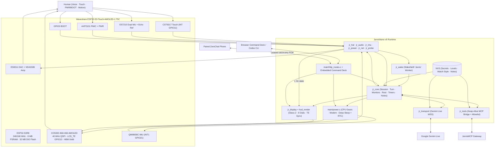
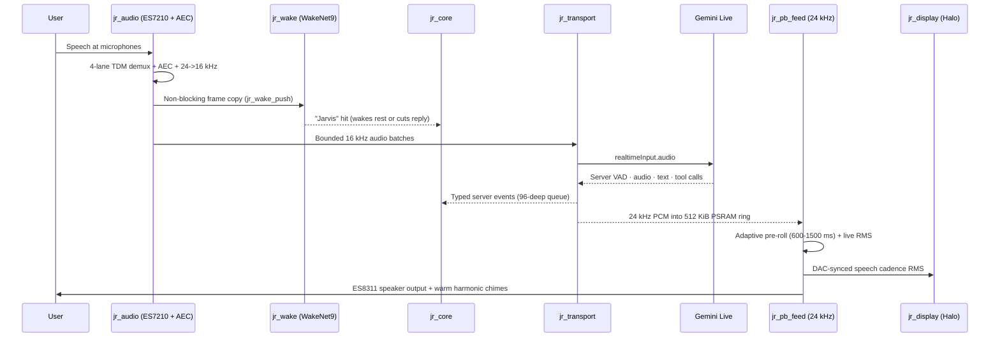
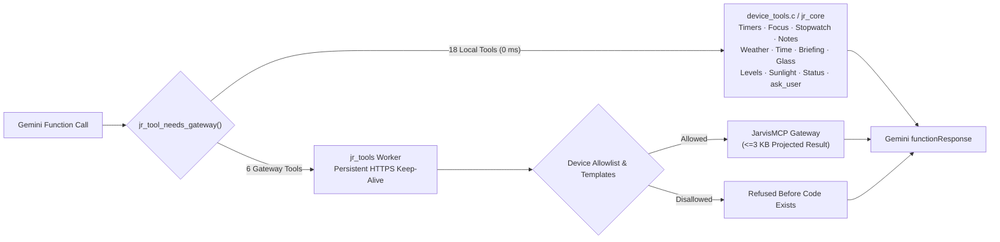
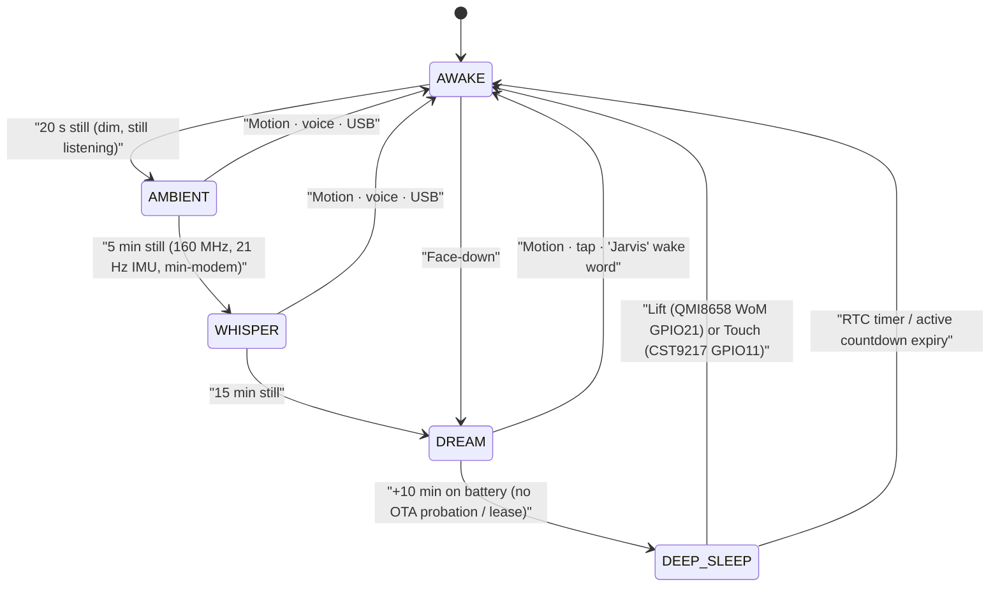
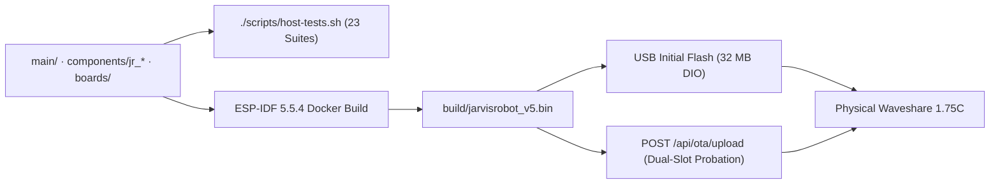

# Architecture

> **Live target:** plain ESP-IDF 5.5.4 on the **Waveshare ESP32-S3-Touch-AMOLED-1.75C**.
> Last reconciled with compiled source: **2026-11-23**.

The firmware image is rooted at `main/`, `components/jr_*`, `firmware/components/jarvis_board`, and `boards/waveshare/esp32s3_touch_amoled_1_75c/`. Legacy `esp-claw/` and `dashboard/` trees are not built by `scripts/build-v5.sh`.

---

## System overview

---

## Single-owner task topology

Every load-bearing subsystem has exactly one owning task; cross-task communication uses bounded queues, atomics, or lock-free packed state words.

| Task / Owner | Responsibility |
|---|---|
| `jr_voice` | Orchestrator (`jr_orch_step`), Gemini events & commands, physical input policy, timers/notes/briefing, rest ladder, privacy, levels, and sleep admission |
| `jr_wake` | Dedicated WakeNet9 `"Jarvis"` worker task (12 KB stack); receives copied 16 kHz frames via `jr_wake_push()` so wake inference never stalls the voice loop or AEC |
| `websocket_task` | TLS/WebSocket transport events only (separate TX lock enabled) |
| `jr_pb_feed` | Event-driven (`ulTaskNotifyTake`) playback feeder draining the 512 KiB PSRAM ring into `esp_codec_dev_write()` behind the adaptive jitter buffer; computes live decimated playback RMS (`jr_audio_playback_live_rms()`) right before the DAC write to drive the speech cadence halo |
| `gfx_render` | Renders 12-row internal-DMA strips, gates frame submission on 60 Hz `LCD_TE` (`GPIO13`) with automatic timeout backoff, and is the **only task** permitted to issue panel commands (`0x51` brightness, `0x66` HBM, `DISPOFF/SLPIN`) |
| `jr_present` | Loads baked `.eaf` faces and caches decoded watch dials in PSRAM (`DIAL_PSRAM_FLOOR` = 2 MB guard) |
| `jr_tools` | Executes bounded JarvisMCP gateway calls over a single persistent HTTPS keep-alive handle (45 s idle expiry, config-gen invalidation, 1-shot stale-EOF reconnect) |
| `httpd` | Serves the zero-dependency embedded **Command Deck** (`GET /`, `main/diagnostics.html`) and authenticated HTTP control plane; never owns realtime state |
| `jr_imu` / `jr_power` | Non-blocking sensor publishers; `jr_imu` scales from 125 Hz normal (`0x26`) in `AWAKE`/`AMBIENT` down to 21 Hz low-power (`0x2D`) in `WHISPER`/`DREAM`, and halts cleanly before handing `INT1` to Wake-on-Motion in deep sleep |

The composition root in `main/` is split across `main.c` (wiring, voice loop, presentation, 1 Hz shell publish), `http_routes.c` (HTTP route authority), `power.c` (CPU gears, deep sleep, RTC state), `device_tools.c` (offline tools, timers, stopwatch, NVS notes, sunlight boost policy, weather, activity), and `diagnostics.html` (embedded Command Deck), sharing `main/app.h`.

Pure C logic in `components/jr_core` (`orchestrator`, `session`, `turn_policy`, `monitors`, `mood`, `timer`, `notes`, `tool_policy`, `dac_mute`, `cue`, `echo_gate`, `glance`, `mic_watch`, `pace`, `utt_watch`, `snapshot`) has zero ESP-IDF dependencies and runs natively under the host test suite.

---

## Voice, wake & playback path

The 1.75C shares one 24 kHz full-duplex I²S clock between ES7210 capture (MIC1/MIC2 + MIC3 echo reference) and ES8311 speaker output. Capture is demultiplexed and downsampled 24→16 kHz for AEC, VAD, `jr_wake`, and Gemini uplink; speaker output remains native 24 kHz.

- **Adaptive jitter buffer:** Gemini paces native audio near real time with 0.8–2.2 s mid-sentence stalls. `jr_pb_feed` holds a 600–1500 ms adaptive pre-roll (stepping +300 ms after any hole, −200 ms after three clean replies) and rebuilds a 1500 ms lead after an underrun. Counters live at `/api/device/health` → `playback`, `rx`.
- **Voice loop timing & benching:** `GET /api/diag/voiceperf` reports per-class loop FPS/latency, tick skips, and `jr_wake` chunk timing; `POST /api/diag/voiceperf?bench=1` runs a 64-frame offline AEC + WakeNet9 microbenchmark.
- **Harmonic earcons:** `jr_audio_play_chime()` uses a warm fundamental + 2nd harmonic (`0.82·sin(f) + 0.18·sin(2f)`) with exponential bell decay and raised-cosine edges for wake cues (`G5→D6`), timer alarms (`E5→B5→E6`), and UI feedback cues.

### Session liveness watchdogs

| Watchdog | Detects | Action |
|---|---|---|
| **Keepalive** (`jr_core/monitors`) | No server frame for the keepalive window | `StaleDeadline` → reconnect with session resume handle |
| **No-reply** (`jr_core/monitors`) | `THINKING` older than 20 s | `NoReplyTimeout` → abandon hung turn |
| **Unanswered utterance** (`jr_core/utt_watch`) | Utterance ≥ 800 ms ends while `LISTENING` with no server frame in 7 s (two in a row) | Inject `StaleDeadline`, caption `RECONNECTING` |

---

## Glass-2 display engine

One procedural + baked-asset compositor drives the 466×466 CO5300 AMOLED in 12-row internal-DMA strips:

- **Spatial ring:** `JARVIS · WATCH · WEATHER · STATUS · ACTIVITY` (plus `DESK` only while a companion is live), composed within measured circular bands (focal ring `r76–96`, safe text disc `r168`, listening halo `r186–193`, battery rim `r215–220`, privacy gold ring `r221–222`, choice arcs `r223–231`).
- **8 luxury watch dials (`jr_watch_style_t`):** `JARVIS`, `DIVER`, `DRESS`, `PILOT`, `MINIMAL`, `FUTURE`, `SKELETON` (oscillating balance wheel), and `CELESTIAL` (14-star foreground parallax). Baked dials decode once into a PSRAM frame cache (`s_dial_frame`) so style switching and redraws avoid flash churn; IMU tilt drives specular bevel/hand lighting and `CELESTIAL` star depth travel.
- **60 Hz TE-synchronized flush (`GPIO13`):** `jarvis_board.c` arms a rising-edge ISR on `LCD_TE` (`GPIO13`, CO5300 `0x35` V-blank mode). `gfx_render` waits on the TE semaphore before flushing frames, with a 1000 ms automatic backoff if TE pulses stop (e.g., while the panel sleeps).
- **CO5300 High-Brightness Mode (`0x66`):** `jarvis_board_set_hbm()` toggles `HBMCTL` (`0x66` bit 1) using `0x63=0xFF` peak DBV, restoring normal `0x51` brightness when turned off. `device_tools.c` enforces a 5-minute auto-revert and refuses HBM if die temperature > 65 °C or battery < 25% off USB.
- **Live overlays:** Countdown timer & Pomodoro ring/banner, 4-lap chronograph stopwatch, live rim volume/brightness arcs, DAC-synced speech waveform halo, and TTL-bounded 466×466 RGB565 remote canvas.

---

## Offline-first tool path (24 voice tools)

Gemini is configured with **24 declared tools** (`DEVICE_TOOL_DECL_COUNT == 24U` in `main/app.h`), split cleanly by `jr_tool_needs_gateway()` (`components/jr_core/src/tool_policy.c`):

- **18 instant offline tools (0 ms):** `current_time`, `weather_here`, `set_volume`, `set_brightness`, `ask_user`, `set_timer`, `cancel_timer`, `list_timers`, `set_glass`, `device_status`, `start_focus`, `stopwatch`, `add_note`, `list_notes`, `clear_notes`, `daily_briefing`, `set_ui_sounds`, `set_sunlight`. All work even with no JarvisMCP gateway configured.
- **6 JarvisMCP gateway tools:** `recall_memory`, `remember`, `search_tools`, `execute_tool`, `delegate_task`, `delegated_tasks`. `jr_tools` maintains a single persistent HTTPS keep-alive client (reused across calls, dropped after 45 s idle or config change) and projects responses into the ≤ 3,072-byte Gemini slot.

---

## Persistent local state & power ladder

### Timers, notes & RTC survival
- **`jr_core/timer`:** Manages countdown timers (5 s–12 h), Pomodoro focus sessions, and a 4-lap chronograph stopwatch. Before deep sleep, `main/power.c` clamps the RTC wake delay to the nearest active timer and writes a magic + FNV-1a checksummed `jr_timer_snapshot_t` into `RTC_NOINIT_ATTR`; on wake, `power_restore_rtc_timers()` restores remaining durations and consumes the snapshot so crashes never replay stale alarms.
- **`jr_core/notes`:** Stores up to 6 pinned desk notes (64 chars each) durably in NVS, accessible by voice (`add_note` / `list_notes` / `clear_notes`), daily briefing, and the Command Deck (`/api/notes`).

### Adaptive rest & deep-sleep ladder

Below 20% battery off USB, the rest ladder advances **4× faster**. Deep sleep refuses to engage while an OTA image is on probation (a cold boot would roll it back), while on USB, or while a companion lease is active.

---

## PSRAM-first SRAM architecture

Contiguous internal SRAM (not total 8 MB PSRAM) is the binding constraint for TLS/AES, I²S/QSPI DMA, and real-time tasks. The firmware enforces a strict PSRAM-first budget:

- **`sdkconfig.defaults`:** `CONFIG_SPIRAM_MALLOC_ALWAYSINTERNAL=1024` routes allocations ≥ 1 KB to PSRAM automatically while keeping `CONFIG_SPIRAM_MALLOC_RESERVE_INTERNAL=65536` reserved for DMA/TLS/task stacks, alongside `CONFIG_MBEDTLS_EXTERNAL_MEM_ALLOC=y`, `CONFIG_SPIRAM_TRY_ALLOCATE_WIFI_LWIP=y`, and `CONFIG_FREERTOS_TASK_CREATE_ALLOW_EXT_MEM=y`.
- **PSRAM-backed subsystems:** `cJSON_InitHooks()` in `main/main.c` routes all JSON AST allocations to PSRAM; playback ring (512 KiB), 128 KB log ring, framebuffer mirrors, remote canvas, baked watch dial cache, `jr_power` charge snapshots, `jr_tools` HTTP body buffers, and `httpd` diagnostic response buffers allocate from PSRAM first.
- **Internal SRAM reserved for:** 12-row QSPI display DMA strip buffers, audio DMA, `jr_voice` owner stack, and TLS AES headroom (≥ 8 KB largest contiguous block monitored by runtime admission gates).

---

## Embedded Command Deck, OTA & build boundary

`main/http_routes.c` serves the zero-dependency **Wi-Fi Command Deck** (`main/diagnostics.html`) at `GET /` with live 466×466 AMOLED mirroring, ring/watch-style switching, Pomodoro/Stopwatch controls, NVS Notes, drag-and-drop RGB565 Canvas push, Codex surface testing, live log tailing, board probing (`/api/diag/board`), and crash forensics (`/api/diag/crash` + ELF coredump summary).

See [`PROTOCOL.md`](PROTOCOL.md) for the complete HTTP and tool contract, [`BUILD.md`](BUILD.md) for build/flash/test workflows, and [`RELEASE_CHECKLIST.md`](RELEASE_CHECKLIST.md) for remaining public-release gates.
