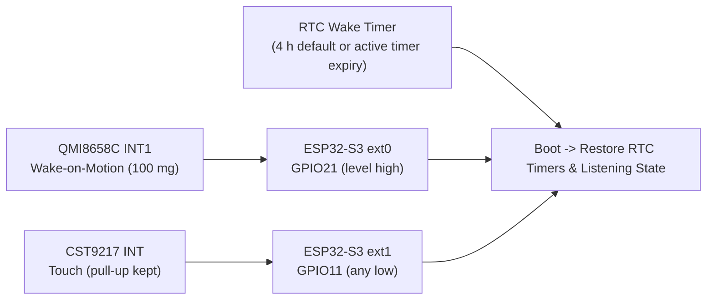

# Hardware

The live product target is the **Waveshare ESP32-S3-Touch-AMOLED-1.75C**.
Pin and peripheral declarations live in [`boards/waveshare/esp32s3_touch_amoled_1_75c/`](../boards/waveshare/esp32s3_touch_amoled_1_75c/), and the schematic-level hardware audit + probe guide lives in [`docs/reference/board-capabilities.md`](reference/board-capabilities.md).

> **Important:** The **1.75C** has **32 MB DIO flash**, an anodised CNC aluminium case, and **no TCA9554 IO expander, PCF85063 RTC, microSD slot, GNSS, or haptic motor**. Never apply original-1.75 or Seeed XIAO pin maps to the 1.75C.

---

## 1.75C silicon & verification status

Every capability below distinguishes what is **hardware-verified on a live 1.75C**, **wired in firmware (pending optical/scope measurement)**, or **hardware-present but unused/unverified**:

| Subsystem | Hardware | Status & firmware role |
|---|---|---|
| **MCU & Memory** | ESP32-S3R8 (240/160 MHz) · 8 MB octal PSRAM · **32 MB DIO @ 80 MHz** | **Verified:** PSRAM-first heap (`ALWAYSINTERNAL=1024`, `cJSON` in PSRAM), dual 4 MB OTA slots, WakeNet9 model, baked `.eaf` faces & dials |
| **Display** | CO5300 466×466 QSPI AMOLED (`40 MHz` bus) | **Verified:** 12-row internal-DMA strip compositor, `0x51` brightness, `DISPOFF`/`SLPIN` sleep |
| **Display TE Sync** | `LCD_TE` → **`GPIO13`** (CO5300 `0x35` V-blank) | **Active in firmware:** rising-edge ISR semaphore in `jarvis_board.c` + `gfx_render` with 1000 ms timeout backoff; live 60 Hz pulse rate probeable via `GET /api/diag/board` |
| **Display HBM** | CO5300 `0x63` (peak DBV `0xFF`) + **`0x66` bit 1** (`HBMCTL`) | **Wired in firmware / optical gain unverified:** `set_sunlight` & `/api/glass?hbm=1` enable `0x66` with 5-min auto-revert and >65 °C / <25% off-USB guards; optical luminance (nits) and current draw not yet photometer-measured |
| **Touch** | CST9217 (`I²C 0x5A`, `INT → GPIO11`, `RST → GPIO2`) | **Verified (1-point):** single-point software gesture classifier + `ext1` deep-sleep wake. **Unverified (2-point):** hardware may report 2 fingers (probeable via `board-probe.py --watch touch`) |
| **Audio** | ES7210 (dual MEMS mics + MIC3 echo ref) · ES8311 DAC · NS4150B amp (`PA_CTRL → GPIO46`) | **Verified:** shared 24 kHz full-duplex I²S clock, 16 kHz AEC uplink, native 24 kHz playback with adaptive jitter buffer |
| **IMU** | **QMI8658C** (`I²C 0x6B`, `INT1 → GPIO21`; `INT2` unconnected) | **Verified (accel + WoM):** ±8 g accel scaling **125 Hz** (`0x26`) in `AWAKE`/`AMBIENT` → **21 Hz** low-power (`0x2D`) in `WHISPER`/`DREAM`; Wake-on-Motion lift-wake passed on `343e51c`. **Gyro:** kept off at runtime to preserve low-power modes, probeable on demand via `/api/diag/board?gyro=1`. *(Note: QMI8658C does not have the QMI8658A's tap/pedometer engines.)* |
| **PMIC** | **AXP2101** (`I²C 0x34`; IRQ not wired to S3) | **Verified (telemetry + soft off):** 1 Hz VBAT/SoC/USB/charge cache, 5 s read-only charge-register diagnostic, PWR short/long I²C latch, soft power-off. Extra ADC channels (`die_c`, `vbus_mv`, `vsys_mv`, `ts_mv`) transiently probeable via `/api/diag/board` (restored afterward). **No battery current ammeter** exists on this chip. |
| **PWR-key mirror** | `PWRON` → BSS138 → `SYS_OUT` (**`GPIO3`**) | **Wired on schematic / unverified on hardware:** probeable via `board-probe.py --watch pwr`. Not yet used as a deep-sleep wake source (GPIO3 strapping & live polarity verification pending). |
| **Radio & USB** | 2.4 GHz Wi-Fi · BLE 5.0 · Native USB-Serial-JTAG (`GPIO19/20`) | **Verified:** Wi-Fi station + minimum modem sleep at rest; BLE intentionally off (coexistence starves duplex audio); USB-C used for initial flash & recovery |
| **Expansion pads** | `GPIO17, 18, 39–42`, `U0TXD/RXD`, shared I²C, `3V3/VBUS/GND` | **Unpopulated pads only** — unused by stock firmware |

---

## 1.75C pin map (schematic-verified)

Cross-checked against the Waveshare 1.75C schematic and `boards/waveshare/esp32s3_touch_amoled_1_75c/*.yaml`:

| GPIO | Net | Firmware role |
|---|---|---|
| `0` | `BOOT` key | Shade toggle, 60 s pairing hold, panic-home, ROM download on reset |
| `1` | `LCD_RESET` | CO5300 panel reset |
| `2` | `TP_RESET` | CST9217 touch reset |
| `3` | `SYS_OUT` | PWR-key MOSFET mirror (read-only probe via `/api/diag/board`; not yet a wake pin) |
| `4, 5, 6, 7` | `QSPI SIO0..3` | CO5300 quad SPI data |
| `8` / `10` | `I2S DOUT` / `DIN` | ES8311 speaker data out / ES7210 TDM mic data in |
| `9` / `45` / `16` | `I2S SCLK` / `LRCK` / `MCLK` | Shared 24 kHz full-duplex audio clocks |
| `11` | `TP_INT` | CST9217 touch IRQ & deep-sleep `ext1` wake |
| `12` / `38` | `LCD_CS` / `QSPI_SCL` | CO5300 chip select & 40 MHz clock |
| `13` | `LCD_TE` | CO5300 60 Hz V-blank tearing-effect sync input |
| `14` / `15` | `I2C SCL` / `SDA` | Shared bus: AXP2101 (`0x34`), ES8311 (`0x30`), ES7210 (`0x80`), CST9217 (`0x5A`), QMI8658C (`0x6B`) |
| `19` / `20` | `USB D-` / `D+` | Native USB-Serial-JTAG |
| `21` | `QMI_INT1` | QMI8658C Wake-on-Motion deep-sleep `ext0` wake |
| `46` | `PA_CTRL` | NS4150B speaker amplifier enable |

---

## Binding hardware constraints

1. **Contiguous internal SRAM** (not total PSRAM) gates TLS/AES handshakes and QSPI/I²S DMA. Maintain ≥ 8 KB largest internal free block via PSRAM-first allocation (`CONFIG_SPIRAM_MALLOC_ALWAYSINTERNAL=1024`, `cJSON` in PSRAM).
2. **One display compositor:** CO5300 transfers use 12-row internal-DMA strips at 40 MHz QSPI (~21.7 ms pure wire time per full 466×466 frame). Do not add LVGL or a second renderer.
3. **No light sleep while capturing:** Full-duplex codec capture prevents ESP-IDF automatic light sleep; power savings come from adaptive CPU gears (`240 / 160 MHz`), 21 Hz rest IMU, Wi-Fi minimum modem sleep, quiet clock cadence, and true deep sleep on battery.
4. **SNTP timekeeping:** With no external PCF85063 RTC on the 1.75C, wall time is SNTP-backed and deep-sleep countdown timers survive via a checksummed `RTC_NOINIT_ATTR` snapshot + clamped RTC timer wake.

---

## Deep-sleep wake topology



Each GPIO wake source is armed only if the pin reads its resting level at sleep entry (preventing boot loops); the RTC timer is always armed and clamped to the nearest active countdown timer. Deep sleep refuses to engage on USB, during OTA probation, or during an active companion lease.

### Live board probe (`scripts/board-probe.py`)

Verify open hardware questions directly on a running 1.75C without flashing debug builds:

```bash
export JARVIS_DEVICE_HOST='<device-ip>'
python3 scripts/board-probe.py                  # GPIO13 TE, GPIO3, IMU regs/temp, PMIC ADC
python3 scripts/board-probe.py --gyro           # + 300 ms QMI8658C gyro pass (restores CTRL3/7)
python3 scripts/board-probe.py --watch pwr      # 3 s window to test GPIO3 PWR-key mirror
python3 scripts/board-probe.py --watch touch    # 4 s window to test 2-finger CST9217 report
```

---

## Compatibility & historical tracks

| Track | Status | Notes |
|---|---|---|
| **Original Waveshare 1.75** | Reference only (`boards/waveshare/esp32s3_touch_amoled_1_75/`) | 16 MB flash, carries PCF85063 RTC, microSD, TCA9554; not release-built |
| **Seeed XIAO ESP32-S3 Sense** | Reference only (`boards/seeed/xiao_esp32s3_sense/`) | Early compact/camera experiment (OV3660/OV2640, PDM-TX PAM8002A); see [`CAMERA.md`](CAMERA.md) |
