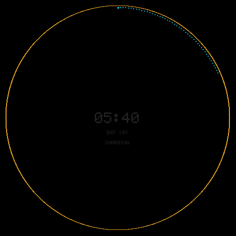

# Quiet HOME image: USB deployment and owner handoff

READY FOR OWNER: battery 22%, USB present and charging at 09:49:28Z. The frozen
`ff18294` image passed probation and authenticated
health on USB with privacy muted. Nightstand redraws are sparse. Forced HOME
while charging still animates; its static quiet-HOME proof remains pending
for the unplugged session. No unplugged drain window was started.

## OTA and privacy

USB was present and charging at 16% on the first readiness read. The existing
OTA guard permitted USB power; no battery threshold or privacy override was
used. Upload began at 09:38:26Z on 2026-10-12. The candidate was observed
`pending-verify`, then `ota_0` / boot `ota_0` / `state=valid` at 09:40:02Z.
Authenticated health confirmed valid/muted at 09:40:03Z and again after the
display checks at 09:44:32Z. The latter battery read was 19%, USB present and
charging. Subsequent read-only battery/USB polls are retained at two-minute
intervals in [the battery receipt](t107-quiet-usb/battery-polls.json).

The uploaded binary is 1,868,096 bytes, SHA-256
`60d51bdf6227fa52fc9388f16f3f86ac66915b1b1a3265f626f2c4933eb41682`, bound
to source commit `ff1829473ddbdae979b9129376b9d1d767222ed1` by the frozen
source manifest, verified again before upload. Partition headroom is 55.461%.
The unchanged source previously passed 15 host suites and rejected 53/53
compiled runtime faults; see [the source and gate report](t107-quiet-home.md).
Firmware version `1` is not the source identity.

Privacy stayed muted, capture and WebSocket streaming were false, voice was
alive, and mic/ADC/DAC/amp were off. The final authenticated health receipt
has no transport drops/deaths or display errors, largest internal block
29,696 bytes and no operator lease. No PMIC setting was changed; CHARGE
remains closed at 200mA. [OTA and health receipt](t107-quiet-usb/ota.json).
The [09:49:28Z handoff readback](t107-quiet-usb/owner-handoff.json) confirms
22%, USB/charging, `ota_0` valid, Nightstand, muted/capture off and audio off.

## Actual redraw and flush counters on USB

Snapshots were taken outside the measured intervals. Readbacks use cumulative
`render_frames` and strip-flush counters, not the scheduler's `actual_fps`.
Nightstand's API `actual_fps` stayed at 5 despite sparse rendering. Flush
completions count panel strips, not full frames.

| State | Window | Redraws | Redraw fps | Submitted/completed strip flushes | Errors |
|---|---:|---:|---:|---:|---:|
| Nightstand, muted WHISPER, brightness 5 | 120.250 s | 3 | 0.02495 | 117 / 117 | 0 |
| Forced HOME run 2, muted AWAKE, brightness 65 | 1.718 s | 13 | 7.56694 | 516 / 516 | 0 |
| Forced HOME run 3, muted AWAKE, brightness 65 | 1.672 s | 13 | 7.77512 | 524 / 524 | 0 |

Nightstand was retained across all 25 readbacks, including minute clock ticks
and a gauge increase from 18% to 19%. Its counters went from 1,084 to 1,087
redraws and 42,286 to 42,403 completed strips. This proves sparse redraws on
the installed image. Nightstand uses its pre-existing companion presenter;
this is not a before/after attribution to the new HOME one-shot repair.
[All Nightstand samples](t107-quiet-usb/nightstand.json).

Forced HOME used the existing synthetic double-HOME input, preserving USB,
charging, privacy and lease semantics. The first measurement crossed the
automatic Nightstand transition and is retained but excluded from the HOME
claim. Runs 2 and 3 remained HOME at both endpoints; their API `actual_fps`
values were 13/13 and 8/12 respectively. These short active windows do not
measure settled WHISPER. [All forced HOME attempts](t107-quiet-usb/forced-home.json).

`quiet_eligible()` explicitly excludes charging (environment bit 8), and
double-HOME resets activity. Muted USB returns to Nightstand after five
seconds. Thus an unchanged, settled charging HOME cannot enter the repaired
quiet path with these APIs. Near-zero HOME redraws on USB are **not proved**.
Source: `components/jr_display/src/jr_display.c:4645` and `main/main.c:890`.

## Captures and next gate

Both captures were opened and reviewed. The Nightstand mirror shows a
near-black 05:40 clock, BAT 18%, CHARGING, battery rim and gold privacy ring.
The forced HOME mirror shows the face, charging rim and gold ring. These are
panel-submission mirrors, not optical photographs or owner acceptance.

[Forced HOME panel mirror](t107-quiet-usb/forced-home.png).

The seven-step `.evidence/t107/OWNER-CHECKLIST.md` session awaits `owner ready`.
Leave the Nano plugged in and muted. After that session, run the fresh paired
B/repair HOME windows of at least 45 minutes, then the unattended natural
ladder/default four-hour timer wake. Battery saving, projected life, optical
wake timing and current-image voice acceptance remain pending. C2 source is
committed at `c4681ad` and remains excluded from this image.
